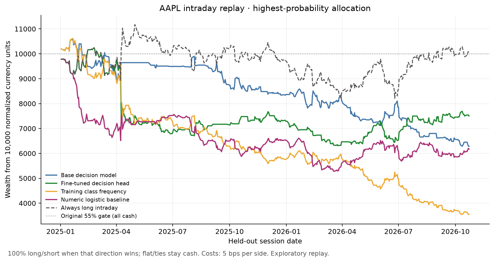

# Highest-probability allocation intraday replay

For each session, add the two down-bin probabilities and the two up-bin probabilities, then compare down, flat and up. Allocate 100% of that strategy’s equity long if up wins, or short if down wins. Flat and tied winners stay in cash. There is no minimum confidence threshold and confidence is not used to scale position size.

AAPL: 454 sessions, 2025-01-02 through 2026-10-23. Signals use the previous completed session; entry is at the next open and exit at that close. Costs are 5 basis points per side, with a 10-basis-point-per-side stress case.

| Model | Long | Short | Cash | Net return | Worst drawdown | Sharpe | Doubled-cost return |
|---|---:|---:|---:|---:|---:|---:|---:|
| base | 2 | 279 | 173 | -37.11% | -40.50% | -1.28 | -52.55% |
| fine_tuned | 312 | 4 | 138 | -24.98% | -38.43% | -0.58 | -45.33% |
| class_frequency | 0 | 454 | 0 | -64.45% | -66.61% | -2.11 | -77.45% |
| numeric_logistic | 257 | 148 | 49 | -38.30% | -47.17% | -0.95 | -58.88% |

Always-long intraday comparator after the same standard costs: 0.70% return and -26.54% worst drawdown.

The fine-tuned rule's compounded return before costs is 2.92%. Its net return includes two transaction-cost charges on each of its 316 active sessions.

This is the user-requested exploratory execution rule applied after the original test was observed. Forecasts, model weights, calibration, dates and labels are unchanged. The original 55% gate results remain in `trading.json` and are not overwritten. This replay is not a new unseen-data validation of the rule.

Positions are synthetic unlevered daily exposures. Borrow fees, financing, taxes, slippage beyond the fixed cost, and short-sale constraints are not fully modeled. Only AAPL has a complete continuous test series; sparse cross-market prediction samples are not used as continuous portfolios.

Per-session allocations and returns: `highest_confidence_trades.csv`. Equity curves: `aapl_highest_confidence_equity_curves.csv`. Full statistics and source hashes: `trading_highest_confidence.json`.

