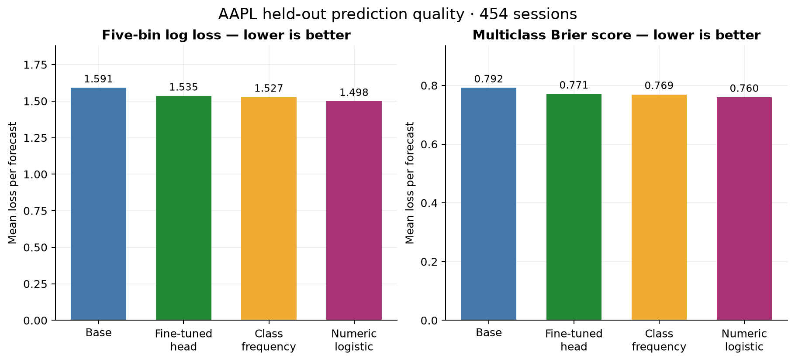
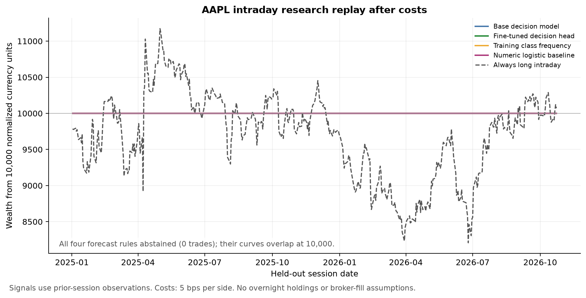
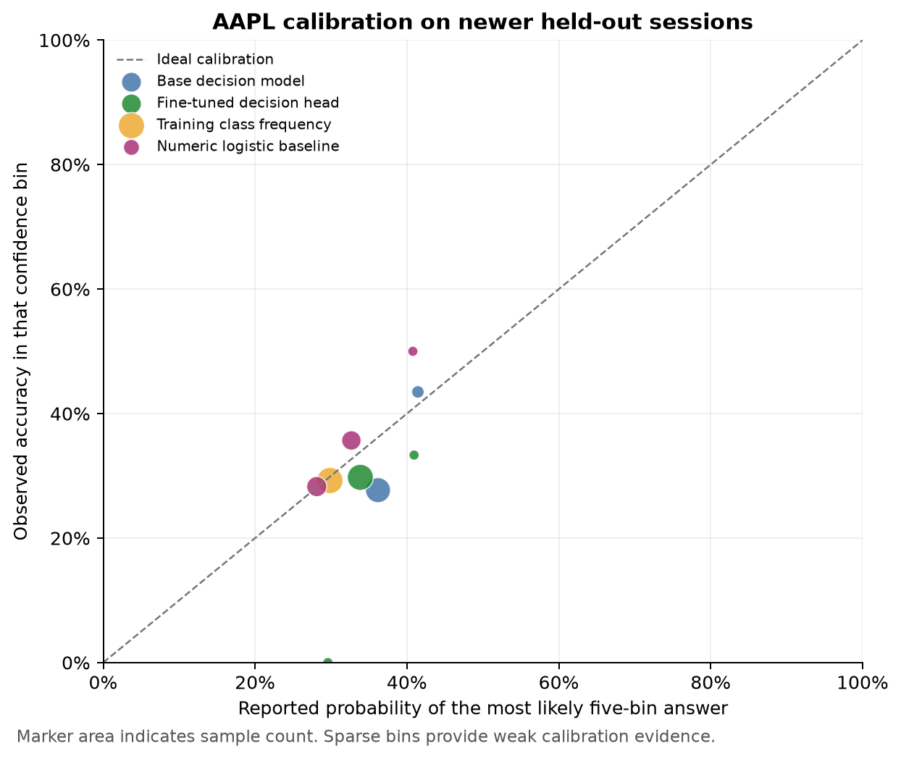

# Measured decision-model market experiment

Selected **d3-edge**, 594,582,720 parameters. Selection used a predetermined 2024 validation sample, not test returns.

Dataset: **268,166** 100-point examples across 34 instruments. **10,752 distinct AAPL training examples**. Historical headlines are available only for a subset of US instruments; all coverage gaps are explicit.

Fine-tuning changed **5,120 original scorer/readout weights** on **AMD Radeon RX 560 Series (RADV POLARIS11) through Vulkan**. The backbone remained frozen. Training ends 2023-12-29; test targets span 2025-01-01 to 2026-10-23.

| Model | AAPL observations | Five-bin accuracy | Three-class accuracy | Log loss | Brier |
|---|---:|---:|---:|---:|---:|
| base | 454 | 0.293 | 0.324 | 1.5906 | 0.7919 |
| fine_tuned | 454 | 0.295 | 0.361 | 1.5348 | 0.7707 |
| class_frequency | 454 | 0.293 | 0.328 | 1.5268 | 0.7693 |
| numeric_logistic | 454 | 0.319 | 0.385 | 1.4980 | 0.7598 |

The fine-tuned model did not improve AAPL log loss versus the training-frequency baseline (1.5348 versus 1.5268). This is the primary predictive comparison.

## Cross-market test diagnostics

| Group | Observations | Base log loss | Fine-tuned log loss | Frequency log loss | Numeric log loss |
|---|---:|---:|---:|---:|---:|
| all | 1246 | 1.5297 | 1.4502 | 1.4766 | 1.4610 |
| US | 718 | 1.5943 | 1.5321 | 1.5204 | 1.5000 |
| India | 192 | 1.5763 | 1.5272 | 1.5191 | 1.5425 |
| Global | 192 | 1.5780 | 1.4551 | 1.4688 | 1.4713 |
| FX | 144 | 1.0813 | 0.9321 | 1.2120 | 1.1444 |

Each non-AAPL instrument contributes 24 predetermined test origins. These sparse panels are forecast diagnostics; only the complete AAPL series supports the continuous intraday replay.

AAPL inputs with retrieved headlines: 454/10,752 training, 0 validation, and 387/454 test. This coverage shift and the absence of a controlled news ablation limit conclusions about news filtering.

Paired block-bootstrap loss difference (fine-tuned minus baseline): 0.0080, 95% interval [-0.0141, 0.0310]. Negative favors fine-tuning.
The interval includes zero: this test does not provide clear evidence of a predictive advantage over class frequencies.

## Illustrative continuous AAPL intraday backtest

| Model | Net return | Worst drawdown | Active fraction | Doubled-cost return |
|---|---:|---:|---:|---:|
| base | 0.00% | 0.00% | 0.00% | 0.00% |
| fine_tuned | 0.00% | 0.00% | 0.00% | 0.00% |
| class_frequency | 0.00% | 0.00% | 0.00% | 0.00% |
| numeric_logistic | 0.00% | 0.00% | 0.00% | 0.00% |

All four forecast rules abstained on every AAPL session under the predeclared 0.55 directional-confidence gate. The zero returns represent **zero trades**, not evidence of profitable execution. The threshold was not changed after seeing test results.

Frozen features used the benchmark-selected FP32 CPU/Vulkan runtime in `runtime_config.json`; parity checks against the original cached encoder outputs are recorded in the runtime benchmark files. Weight updates use the native Vulkan scorer.

## Interpretation and limits

- Retrospective foundation pretraining overlap unknown.
- Historical news missing for many markets and test dates.
- Only final scorer/readout is trained; backbone frozen.
- Small convenience universe and sparse non-AAPL test sample.
- Validation reused for model selection/hyperparameters/temperature; validation score optimistic.
- Illustrative intraday execution and costs; no broker fills.
- Headlines-versus-no-headlines diagnostic groups cover different dates; they do not estimate a causal news benefit.
- The intraday target excludes overnight news gaps.
- The long AAPL training history spans very different market regimes.
- Reported backtests are open-to-close synthetic exposures with explicit costs, not broker executions.
- Missing archive news does not mean no market-moving event occurred.
- The noise filter is heuristic salience metadata, not a human-verified relevance dataset.
- A correct typed answer format is not evidence of financial accuracy.

Full per-market/per-symbol results: `forecast_metrics.csv`. Per-origin probabilities and labels: `test_predictions.parquet`. Parameter updates and exact scope: the saved `adapter_config.json`. Vulkan forward/backward/update checks: `vulkan_parity.json`.

## Validation candidate comparison

| Candidate | Parameters | Validation log loss |
|---|---:|---:|
| laya | 421,293,827 | 1.6891 |
| d3-edge | 594,582,720 | 1.5023 |

## Measured test figures

